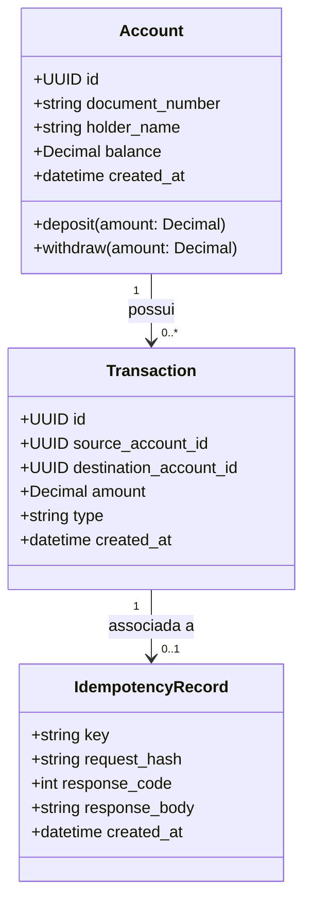
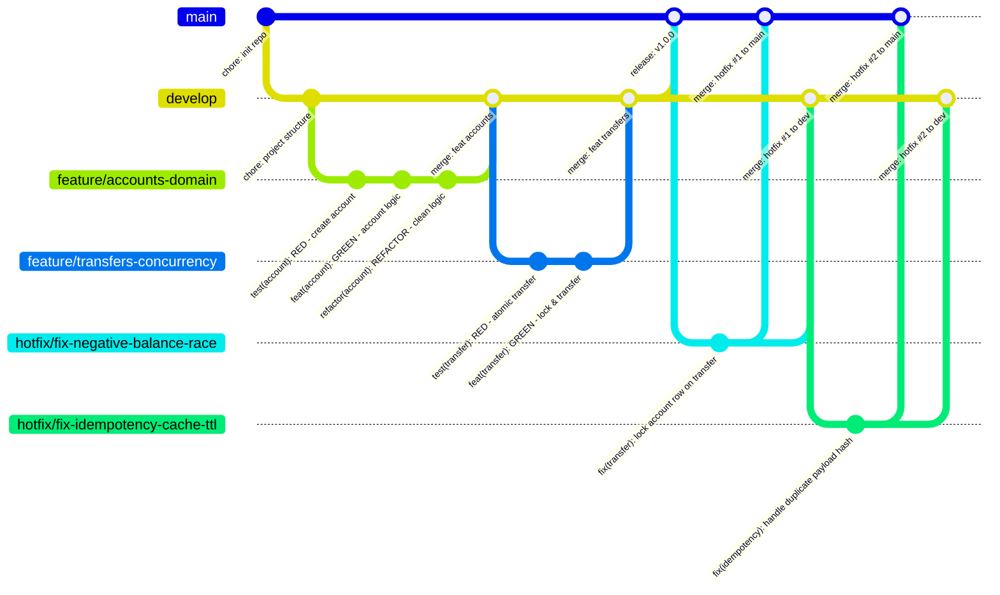

# RELATÓRIO TÉCNICO DE ENGENHARIA DE SOFTWARE
## API de Microsserviço Financeiro com Automação CI, Suíte de Self-Testing Multinível e Git Flow

---

## 1. Identificação do Projeto
* **Sistema:** Wallet API (Microsserviço de Conciliação Bancária e Carteira Digital)
* **Stack Tecnológica:** Python 3.12, FastAPI, SQLAlchemy, SQLite (em memória para testes e persistente para app), PyTest, Locust
* **Modelo de Branching:** Git Flow
* **Abordagem de Desenvolvimento:** TDD (*Test-Driven Development*) com pirâmide de testes completa (Unitários, Integração e E2E)
* **Pipeline de Integração Contínua:** GitHub Actions com *Coverage Gate* obrigatório

---

## 2. Documento de Especificação de Requisitos de Software (SRS)

### 2.1. Requisitos Funcionais (RF)

| ID | Nome | Descrição | Regras de Negócio e Critérios de Aceite |
| :--- | :--- | :--- | :--- |
| **RF-01** | **Criação de Conta Digital** | Permitir a abertura de nova conta digital com saldo inicial. | - Saldo inicial não pode ser negativo.<br>- O titular deve passar por validação cadastral (KYC).<br>- Cada conta recebe um identificador único (UUID). |
| **RF-02** | **Consulta de Conta Digital** | Permitir a consulta de dados e saldo atualizado de uma conta existente. | - Retornar dados da conta e saldo atual.<br>- Retornar HTTP 404 caso a conta não exista. |
| **RF-03** | **Transferência entre Contas** | Transferir saldo entre uma conta de origem e uma de destino. | - Débito na origem e crédito no destino devem ser atômicos (transação ACID).<br>- Rejeitar se saldo da origem for insuficiente (HTTP 422).<br>- Rejeitar se conta de origem for idêntica à de destino.<br>- Rejeitar valores menores ou iguais a zero. |
| **RF-04** | **Tratamento de Idempotência** | Garantir que transferências com a mesma chave de idempotência não sejam duplicadas. | - O cabeçalho `Idempotency-Key` (UUID) é obrigatório nas transferências.<br>- Se uma requisição com chave idêntica for reenviada, a API deve retornar a resposta original em cache sem reprocessar débito/crédito. |
| **RF-05** | **Consulta de Extrato Filtrado** | Listar movimentações financeiras de uma conta com filtros. | - Permitir filtrar por intervalo de datas (`start_date`, `end_date`).<br>- Permitir filtrar por tipo de transação (`DEBIT`, `CREDIT`).<br>- Exibir histórico ordenado cronologicamente (decrescente). |
| **RF-06** | **Integração com Anti-Fraude** | Notificar serviço externo fictício de anti-fraude a cada transferência executada. | - Enviar payload contendo ID da transação, contas envolvidas, valor e timestamp via webhook/HTTP.<br>- Validar status do serviço externo para autorização ou alerta. |

### 2.2. Requisitos Não Funcionais (RNF)

| ID | Categoria | Descrição e Métrica de Verificação |
| :--- | :--- | :--- |
| **RNF-01** | **Consistência e Concorrência** | O sistema deve tratar condições de corrida (*race conditions*) em transferências simultâneas na mesma conta, utilizando bloqueio transacional pessimista ou controle otimista com isolamento estrito, impedindo saldo negativo. |
| **RNF-02** | **Latência e Desempenho** | Sob carga de 50 requisições concorrentes simultâneas no endpoint de transferência, o percentil 95 ($p95$) de tempo de resposta deve ser inferior a 500ms e a taxa de erro técnico (5xx) deve ser de 0%. |
| **RNF-03** | **Cobertura de Código (Quality Gate)** | A suíte de testes automatizados deve atingir no mínimo **80% de cobertura de branches** e **85% de cobertura de linhas/statements**, auditada via `pytest-cov` e bloqueando a pipeline CI em caso de descumprimento. |
| **RNF-04** | **Arquitetura em Camadas** | O código deve seguir estrita separação de responsabilidades: *Domain*, *Services*, *Repositories* e *Controllers*, sem acoplamento direto entre HTTP e regras de negócio. |
| **RNF-05** | **Isolamento de Testes** | A execução dos testes não deve depender de serviços externos reais, utilizando SQLite em memória e Test Doubles (Mocks e Stubs). |
| **RNF-06** | **Rastreabilidade Git** | Todo o ciclo de vida deve ser auditável via Git Flow, com histórico contendo commits semânticos, evidência do ciclo *Red-Green-Refactor* e pelo menos 2 correções emergenciais (*hotfixes*) documentadas. |

---

## 3. Arquitetura do Sistema e Design

### 3.1. Arquitetura em Camadas (Layered Architecture)

A aplicação adota separação clara em 4 camadas:

```
src/
├── domain/         # Entidades de negócio ricas, Value Objects e regras puras (Account, Transaction, Money)
├── repositories/   # Interfaces e implementações de persistência com SQLAlchemy
├── services/       # Casos de uso, orquestração de transações, idempotência e chamadas externas
└── controllers/    # Endpoints HTTP FastAPI, validação de schema Pydantic e tradução de erros
```

### 3.2. Modelo de Dados e Entidades



### 3.3. Tratamento de Concorrência e Transação Atômica

Para garantir que duas transferências concorrentes debitando da mesma conta não gerem saldo negativo (problema do *double-spending*):
1. A transação inicia no banco de dados com isolamento transacional.
2. É aplicado ordenamento de IDs de contas para travamento (`with_for_update`), evitando *deadlocks*.
3. O saldo é verificado e debitado/creditado no mesmo bloco atômico. Se o saldo for insuficiente, ocorre rollback imediato.

---

## 4. Estratégia de Branching: Git Flow

O projeto adota formalmente o modelo **Git Flow**:



### 4.1. Regras do Repositório
* **`main`**: Branch de produção. Recebe **apenas** merges de branches de `release/*` ou `hotfix/*`. Commits diretos são estritamente proibidos.
* **`develop`**: Branch de integração contínua de novas funcionalidades.
* **`feature/*`**: Ramificações para desenvolvimento de novas funcionalidades, sempre originadas de `develop` e devolvidas a ela.
* **`hotfix/*`**: Ramificações emergenciais para correção de bugs críticos em produção. Originam-se de `main` e, ao serem concluídas, são mergeadas tanto em `main` quanto em `develop`.

### 4.2. Padrão de Commits
1. **Conventional Commits**: `feat:`, `fix:`, `test:`, `refactor:`, `docs:`, `chore:`.
2. **Ciclo TDD**: Os commits de regras de negócio devem identificar explicitamente a fase do TDD:
   * `test(...): RED - Caso de teste que falha`
   * `feat(...): GREEN - Código mínimo que faz o teste passar`
   * `refactor(...): REFACTOR - Limpeza e melhoria sem alterar comportamento`

---

## 5. Estratégia da Pirâmide de Testes & Test Doubles

A suíte de testes respeita a pirâmide de testes de Martin Fowler:

```
       /\
      /  \     E2E Tests (10%) - FastAPI TestClient, rotas HTTP reais, fluxos completos
     /----\
    /      \   Integration Tests (30%) - SQLite em memória, Mocks e Stubs
   /--------\
  /          \ Unit Tests (60%) - TDD puro, cálculo financeiro, entidades de domínio
 /------------\
```

### 5.1. Distinção Mandatória de Test Doubles
* **Mocks (Verificação de Interações de Saída):**
  * Utilizados na integração com o gateway externo fictício de **Anti-Fraude**.
  * O teste deve inspecionar e assegurar:
    1. A rota do webhook foi chamada (`assert mock.called`).
    2. A contagem exata de chamadas (`call_count == 1`).
    3. Os parâmetros enviados no payload (`account_id`, `amount`, `transaction_id`).
* **Stubs (Alimentação de Dados de Entrada Controlados):**
  * Utilizados para simular serviços de apoio externo:
    1. **Validação cadastral (KYC):** Retorno pré-programado de cliente aprovado ou bloqueado sem consultar serviço externo real.
    2. **Serviço de Câmbio/Taxas:** Prover taxa fixa controlada para conversões previsíveis.

---

## 6. Pipeline de Integração Contínua (CI)

O workflow do GitHub Actions (`.github/workflows/ci.yml`) é acionado automaticamente em eventos de `push` e `pull_request` nas branches `main` e `develop`.

### Etapas do Pipeline:
1. **Checkout do Código.**
2. **Setup do Ambiente Python 3.12 com Cache de Dependências.**
3. **Instalação de Dependências.**
4. **Linter & Análise Estática (`flake8`):** Verificação de padrões de formatação e boas práticas.
5. **Execução Automatizada das Suítes:** Testes unitários, de integração e ponta a ponta.
6. **Coverage Gate Enforcement:** O comando `pytest --cov --cov-branch --cov-fail-under=85` encerra com código de erro se:
   * A cobertura de linhas for $< 85\%$.
   * A cobertura de ramificações (*branches*) for $< 80\%$.
7. **Publicação de Artefatos:** Armazenamento do relatório HTML/XML de cobertura e logs de execução.

---

## 7. Testes de Carga e Resiliência sob Concorrência

Para avaliar o comportamento da API sob estresse e validar o tratamento de concorrência e idempotência:
* **Ferramenta:** Locust.
* **Cenário:** Simulação de no mínimo 50 usuários virtuais concorrentes requisitando transferências simultâneas sobre as mesmas contas.
* **Critérios de Sucesso:**
  1. Ausência de inconsistência de saldo (sem saldo negativo ou dinheiro criado do nada).
  2. Latência média dentro do limite aceitável.
  3. Rejeição limpa (HTTP 422 - Saldo Insuficiente) sem gerar erros 500 no servidor.
* **Resultados e Métricas:** Registrados no Apêndice deste relatório após a execução da Fase 3.
